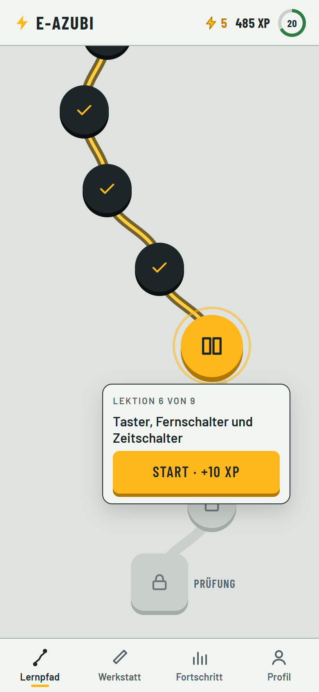
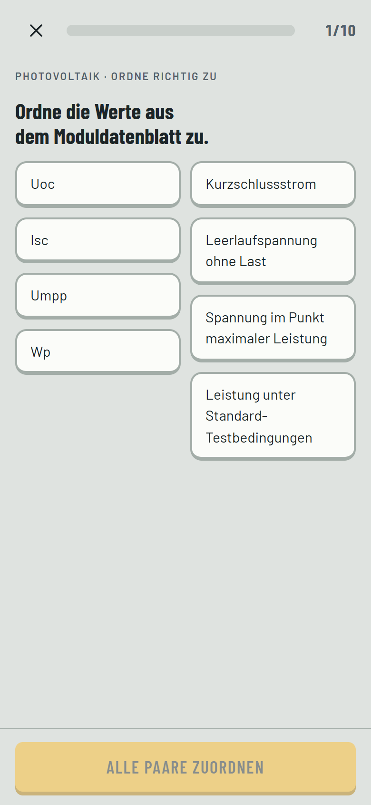
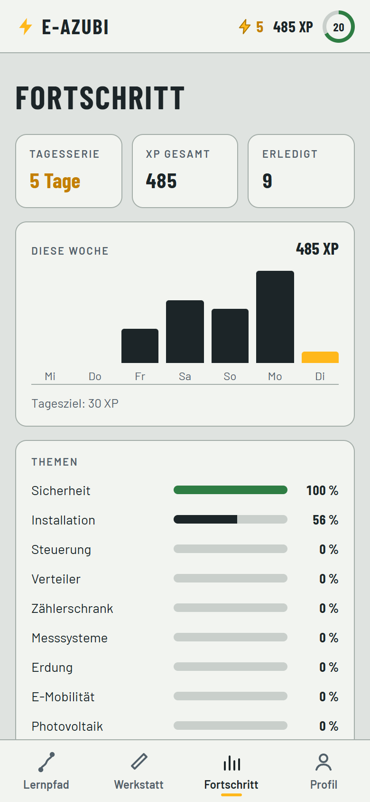
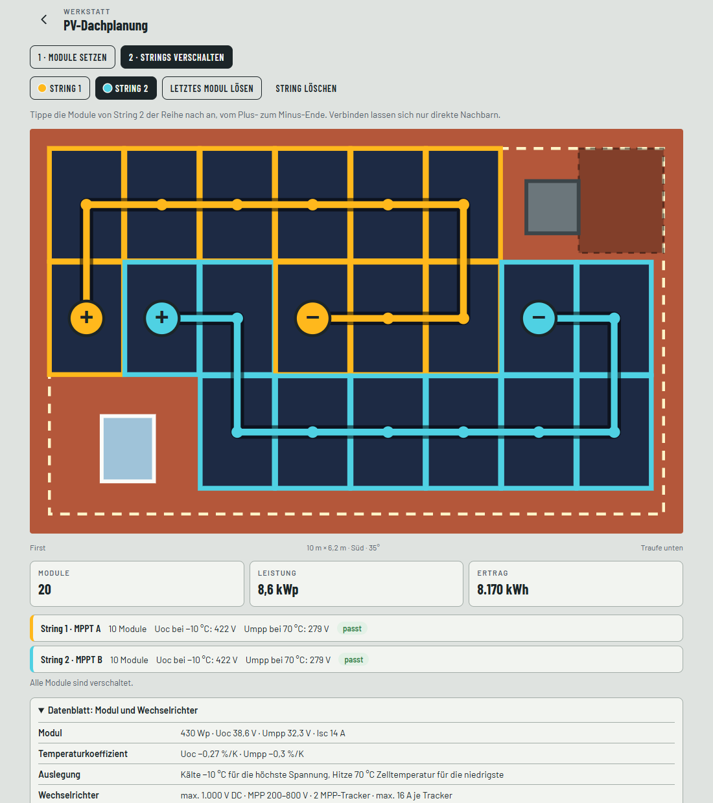
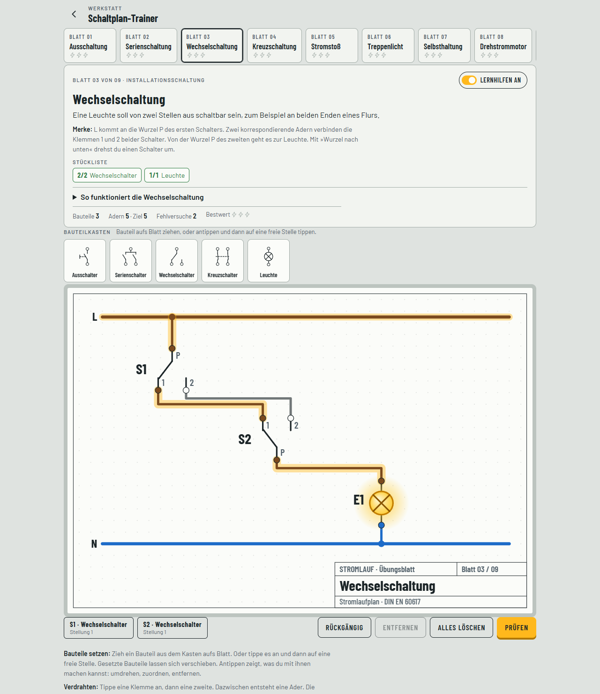
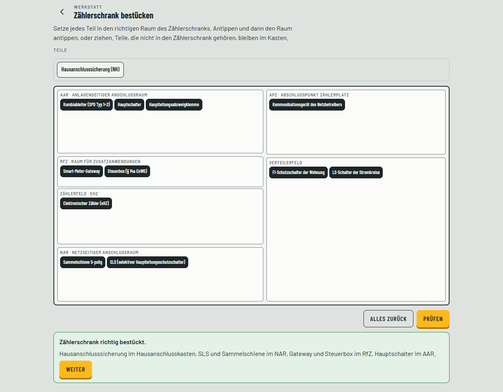
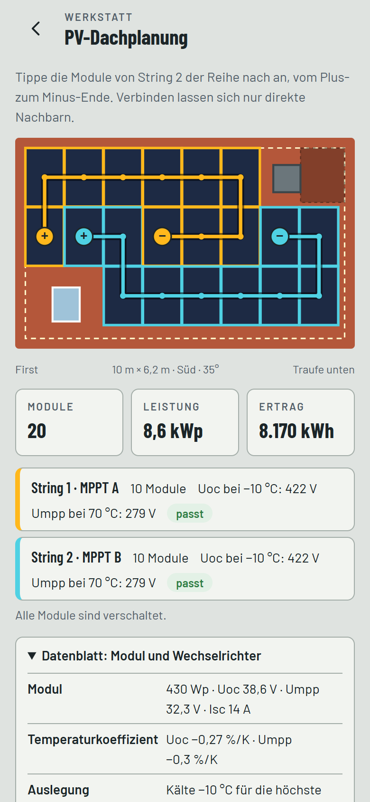
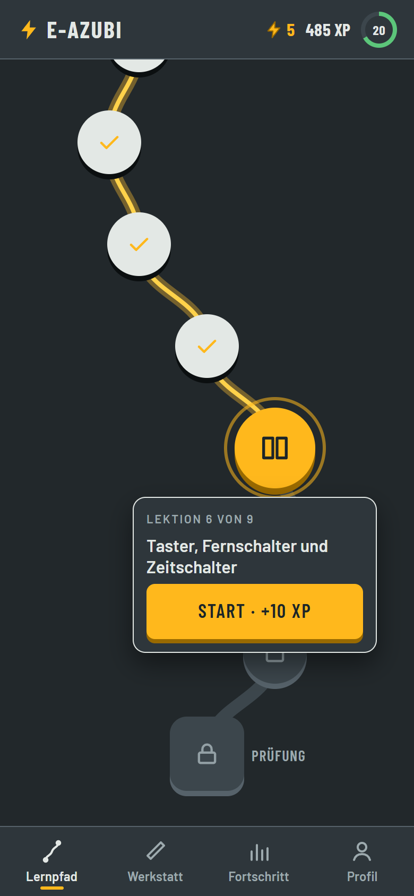

# E-Azubi Trainer

Lern-App für Auszubildende im Elektrohandwerk. Ein Lernpfad wie bei Duolingo führt durch Lektionen, Praxisaufgaben und Abschnittstests. Die Azubis sammeln dabei XP, halten eine Tagesserie und verdienen Abzeichen.

**App öffnen:** https://rau-elektrik.github.io/e-azubi-trainer/

## So sieht die App aus

<p>
  
  
  
</p>

**PV-Dachplanung:** Module setzen, dann zu Strings verschalten. Die App rechnet die Stringspannung bei −10 °C und 70 °C und prüft sie gegen den Wechselrichter.



**Schaltplan-Trainer:** Bauteile aufs Blatt ziehen, verdrahten, schalten. Die Adern zeigen ihr Potential, die Lampe leuchtet, wenn der Plan stimmt.



**Zählerschrank nach VDE-AR-N 4100:2026-04:** Jedes Teil in den richtigen Raum setzen, vom NAR bis zum Verteilerfeld.



**Auf dem Handy und im dunklen Design:**

<p>
  
  
</p>

## Inhalte (Version 1.3)

| Abschnitt | Lektionen | Praxis |
| --- | --- | --- |
| 1 · Sicherheit und Grundlagen | Fünf Sicherheitsregeln, ohmsches Gesetz und Leistung, Aderfarben und Schutzmaßnahmen | – |
| 2 · Installationsschaltungen | Schalter und Schaltstellen, Taster und Zeitschalter | Aus-, Serien-, Wechsel-, Kreuz-, Stromstoß- und Treppenlichtschaltung zeichnen |
| 3 · Steuerungstechnik | Schütz, Drehstrommotor, Wendeschützschaltung | Selbsthaltung, Motor anschließen, Wendeschaltung |
| 4 · Verteiler bestücken | Aufbau, Reihenfolge, FI-Typen | Wohnungsverteiler |
| 5 · Zählerschrank (VDE-AR-N 4100:2026-04) | Aufbau, Regeln und Zuständigkeit | Zählerschrank bestücken |
| 6 · Messsysteme | mME, iMSys, Gateway, Pflichtfälle, § 14a | – |
| 7 · Erdung und Messen | Erder nach DIN 18014, Erdungswiderstand messen | Sondenmethode mit Plateau |
| 8 · E-Mobilität | Wallbox planen, Stecker und Kommunikation | Wallbox im Verteiler nachrüsten |
| 9 · Photovoltaik | Anlage berechnen, Planung und Betrieb, Strings auslegen | Dach belegen und Strings verschalten |

### Berufsschule

Der Bereich **Schule** folgt dem KMK-Rahmenlehrplan für Elektroniker/-innen (Beschluss vom 18.12.2020) und der Elektroniker-Ausbildungsverordnung von 2021, Fachrichtung Energie- und Gebäudetechnik. Die Azubis wählen ihr Lehrjahr und sehen die Lernfelder dazu. Jedes Lernfeld hat mehrere Lektionen, eine Lernkarte und einen Lernfeldtest. Jede Frage gehört zu einem Fach: Fachkunde, Fachrechnen, Schaltpläne, WiSo oder Fachenglisch.

| Lehrjahr | Lernfelder |
| --- | --- |
| 1 | LF 1 Systeme analysieren und Fehler beheben · LF 2 Elektrische Systeme planen und installieren · LF 3 Steuerungen und Regelungen · LF 4 Informationstechnische Systeme |
| 2 | LF 5 Energieversorgung und Sicherheit · LF 6 Systeme analysieren und prüfen · LF 7 Steuerungen programmieren · LF 8 Energiewandlungssysteme |
| 3 | LF 9 Kommunikation in Wohn- und Zweckbauten · LF 10 Geräte und Anlagen der Haustechnik · LF 11 Energietechnische Systeme |
| 4 | LF 12 Anlagen planen und realisieren · LF 13 Systeme anpassen und dokumentieren |
| alle | Wirtschafts- und Sozialkunde |

Dazu gibt es ein **Training nach Fach** (10 Aufgaben aus allen Lernfeldern bis zum gewählten Lehrjahr) und ein **Prüfungstraining** für Teil 1 (LF 1 bis 6, 20 Aufgaben) und Teil 2 der Gesellenprüfung (alle Lernfelder und WiSo, 30 Aufgaben). Bestanden ist es wie in der Prüfung ab 50 %.

**Fehler wiederholen:** Jede falsch beantwortete Frage aus Lernpfad und Schule landet auf einer Liste. Unter Schule und Fortschritt steht, wie viele Fragen warten. Eine Runde übt bis zu 10 davon, die neuesten und häufigsten Fehler zuerst. Nach zwei richtigen Antworten hintereinander ist eine Frage erledigt.

Dazu kommt die **Werkstatt**: Dort lassen sich alle Praxisaufgaben frei üben. Es gibt dort ein freies Zeichenblatt für eigene Stromlaufpläne und ein Netz-Puzzle zum Abschalten.

## Installieren

Der Trainer ist eine installierbare Web-App (PWA). Er läuft auf Handy, Tablet und PC und funktioniert nach dem ersten Öffnen auch offline.

- **Android und PC (Chrome, Edge):** Seite öffnen, im Browsermenü »App installieren« wählen. Oder in der App unter Profil auf »Jetzt installieren« tippen.
- **iPhone und iPad (Safari):** Seite öffnen, auf Teilen tippen, dann »Zum Home-Bildschirm«.

Updates kommen automatisch. Nach einer neuen Veröffentlichung zeigt die App »Eine neue Version ist da« mit dem Knopf »Jetzt laden«.

Der Fortschritt liegt nur auf dem jeweiligen Gerät. Unter Profil lässt er sich als Datei sichern und auf einem anderen Gerät wieder laden.

### Warum keine EXE?

Eine Web-App braucht keinen Installer und keine Virenschutz-Ausnahme. Sie läuft auf jedem Gerät, auch auf dem Handy der Azubis, und aktualisiert sich von selbst. Falls später doch eine Windows-Datei gebraucht wird, lässt sie sich aus diesem Projekt bauen, zum Beispiel mit Tauri oder Electron.

## Weiterentwickeln

Das Projekt kommt ohne Build-Schritt aus. Alle Dateien liegen so, wie sie im Browser laufen.

```
index.html               App-Hülle
css/app.css              Aussehen (hell und dunkel)
js/main.js               Lernpfad, Werkstatt, Fortschritt, Profil, Updates
js/lesson.js             Ablauf einer Lektion und die Aufgabentypen
js/store.js              Fortschritt, XP und Tagesserie
js/fehler.js             Fehler wiederholen: Liste der falsch beantworteten Fragen
js/content/kurs.js       Reihenfolge der Abschnitte und XP-Regeln
js/content/abschnitte/   ein Abschnitt pro Datei: Lernkarte, Lektionen, Praxis, Test
js/content/schule/       Berufsschule: Lernfelder je Lehrjahr (jahr1.js bis jahr4.js), WiSo, Fächer, Prüfungstraining
js/content/abzeichen.js  Abzeichen
js/practice/             Praxisaufgaben: Schaltplan, Verteiler, Zählerschrank, Erdung, PV, Netz-Puzzle
tests/run-tests.mjs      automatische Prüfungen
tools/                   Testserver, Bildschirmfotos, App-Symbole, Fragenkatalog
docs/screenshots/        Bilder für diese Seite
sw.js                    Offline-Speicher und Update-Meldung
```

### Eine Frage ergänzen

Öffne die Datei des Abschnitts, zum Beispiel `js/content/abschnitte/verteiler.js`, und füge in `items` einer Lektion eine Zeile hinzu:

```js
{ t: 'choice', q: 'Wie breit ist eine Teilungseinheit?', a: ['17,5 mm', '18 mm', '20 mm', '35 mm'], r: 0, x: 'Eine TE ist 17,5 mm breit.' }
```

| Typ | Bedeutung | Lösung `r` |
| --- | --- | --- |
| `choice` | eine richtige Antwort | Nummer der Antwort, ab 0 gezählt |
| `multi` | mehrere richtige Antworten | Liste der Nummern, z. B. `[0, 2]` |
| `tf` | richtig oder falsch | `true` oder `false` |
| `order` | Reihenfolge | entfällt, `a` steht in der richtigen Reihenfolge |
| `match` | Paare zuordnen | entfällt, `a` ist eine Liste von Paaren |
| `num` | Rechenaufgabe | Zahl, dazu `tol` (Toleranz) und `unit` |

`x` ist die Erklärung, die nach der Antwort erscheint.

Im Bereich Berufsschule stehen die Fragen in `js/content/schule/jahr1.js` bis `jahr4.js` und `wiso.js`. Jede Lektion hat ein Fach (`fach: 'fk'`), das für alle ihre Fragen gilt. Eine einzelne Frage kann mit `f: 'en'` einem anderen Fach zugeordnet werden. Die Fächer stehen in `js/content/schule/faecher.js`. Neue Lektionen hängst du am besten hinten an, sonst verschieben sich die gespeicherten Fortschritte. Muss eine Lektion dazwischen, bekommt sie einen eigenen `key`.

### Einen Abschnitt ergänzen

1. Eine neue Datei in `js/content/abschnitte/` anlegen. Am einfachsten kopierst du eine vorhandene.
2. Sie in `js/content/kurs.js` importieren und in `ABSCHNITTE` eintragen.
3. Die Datei in `sw.js` in die Liste `CORE` aufnehmen, damit sie offline verfügbar ist.

### Testen und veröffentlichen

```bash
npm start
```
startet die App unter http://localhost:4880. Auf dem eigenen Rechner läuft sie ohne Offline-Speicher, damit Änderungen sofort sichtbar sind.

```bash
npm test
```
prüft alle Schaltpläne, Praxisaufgaben und Fragen. Beim Hochladen auf GitHub laufen dieselben Prüfungen automatisch.

```bash
npm run screenshots
```
erneuert die Bilder in `docs/screenshots/`. Das Skript öffnet ein unsichtbares Chrome mit einem Beispiel-Fortschritt. Liegt Chrome woanders, gibst du den Pfad mit der Umgebungsvariable `CHROME` an.

```bash
npm run katalog -- Fragenkatalog.html
```
schreibt alle Fragen der Berufsschule als druckbare HTML-Datei, nach Lehrjahr, Lernfeld und Lektion. Jede Frage steht mit Fach, allen Antworten, markierter Lösung, Erklärung und einer leeren Zeile für Anmerkungen darin. So lässt sich der Stoff ausgedruckt fachlich prüfen.

**Neue Version veröffentlichen:**

1. Die Versionsnummer erhöhen, und zwar gleich in `js/version.js`, `sw.js` und `package.json`. Neue Dateien in `sw.js` in die Liste `CORE` eintragen.
2. Den Eintrag in `CHANGELOG.md` ergänzen.
3. Hochladen (`git push`). GitHub Pages baut die Seite in ein bis zwei Minuten neu, danach meldet die App das Update.

## Fachlicher Hinweis

Die Inhalte folgen unter anderem DIN VDE 0100, DIN VDE 0105-100, VDE-AR-N 4100 (Fassung 2026-04), DIN 18014, DIN VDE 0100-722, dem Messstellenbetriebsgesetz und § 14a EnWG. Die App dient dem Lernen. Verbindlich sind immer der Normtext und die Technischen Anschlussbedingungen (TAB) des zuständigen Netzbetreibers.
